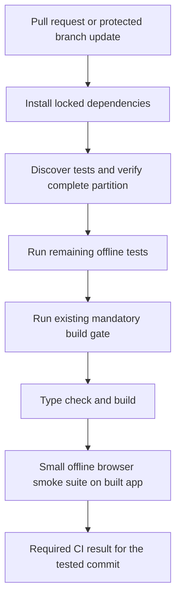

# Test system audit and restructuring proposal

The suite needs clearer boundaries and stronger checks across application layers. The current evidence does not support deleting a large fraction of it simply because it contains about a thousand cases. Many inexpensive cases protect distinct calculation and data rules. The most useful restructuring would make those protections easier to understand, expose hidden mocks, and verify the complete paths where previous incidents occurred.

## Baseline and method

Audited checkout: `4d7249d`, branch `codex/performance-phase-two`, November 9, 2026. The checkout was clean before this report. Analysis ran solo and used the installed dependencies.

- A fresh full offline run passed **1,005 cases in 140 files**, with zero failures or pending cases. Outer local wall time was **9.90 seconds**, using Node **24.18.1**. GitHub CI currently selects Node 22; this local timing is not a measured CI duration.
- All 140 files were inventoried using their source, imports, environment annotations, assertions, mocks, and executed test names. Detailed source review concentrated on safety, storage/authentication, ranking, UI flows, and apparent overlaps. This is not a mutation score or an exhaustive proof of every assertion's effectiveness.
- The request-boundary audit passed for **222 runtime modules**.
- Actual Vitest discovery for the current CI commands partitions the suite into **284 mandatory cases / 37 files** and **721 remaining cases / 103 files**. Comparing case occurrences found **zero overlaps, omissions, or extras**.
- Case comparison preserves repeated names: nine different retired route handlers currently share one test title. A plain set of names would incorrectly collapse eight valid cases.

No application/test implementation, dependency, deployment, provider request, stored user data, development server, or schedule was changed. The build was not rerun for this documentation-only audit.

## Current categories

These are mutually exclusive categories by each file's primary responsibility. Some files combine techniques; safety is a separate concern that spans several categories. Test-body times sum individual case durations and overlap because files execute in parallel; they do not add up to wall time.

| Primary responsibility | Files | Cases | Summed test-body time | Direction |
| --- | ---: | ---: | ---: | --- |
| Domain rules and calculation | 53 | 452 | 0.65 s | Keep distinct rules; consolidate fixtures where helpful |
| Server services and adapters | 34 | 266 | 2.34 s | Keep boundary contracts; strengthen storage semantics |
| Browser clients and persistence | 18 | 89 | 1.22 s | Merge overlapping wrapper checks; preserve recovery and data behavior |
| API handlers | 15 | 81 | 1.91 s | Exercise more actual application layers under each handler |
| React screens and context | 14 | 57 | 3.12 s | Keep interactions; improve selectors and add a few complete flows |
| Tooling and configuration | 5 | 23 | 2.59 s | Retain runtime, audit, partition, and retirement protection |
| Ranking reference matrix | 1 | 37 | 8.12 s | Preserve every distinct scenario; profile its cost separately |
| **Total** | **140** | **1,005** | **19.95 s** | |

There are **119 Node files and 21 jsdom files**. Fourteen files render React; the other seven jsdom files exercise browser facilities. No Playwright suite, configured coverage provider, or mutation-testing tool is currently present in the package/configuration inspected.

## Findings and concrete candidates

### A small amount of clearly low-value coverage

`src/testing/offlineSetup.test.ts:7` installs a fetch mock and asserts that its configured response comes back. This checks the mock's arrangement rather than application behavior. Remove that case; retain the preceding case that proves unmocked fetch is denied. If a real setup-order concern exists, test that concern directly.

`src/lib/browserFailureScope.test.ts:5` and the HTTP-500 row in `src/lib/safeImportFetch.test.ts:5` both verify that an internal API failure does not permanently ban later access. Consolidate their status/route/method examples into one table. Keep the separate obsolete-marker and network-failure/redaction scenarios, which protect different behavior.

`lib/real500Policy.test.ts:8` overlaps the transport tests' query/account-family blocking assertions in `lib/guardedUpstreamFetch.test.ts:34` and `:46`. Consolidate ownership of this contract after mapping the exact variants. Keep the independent fresh-module, queue, persistence-failure, provider, status, cancellation, legacy-history, and known-UFC cases. Merely putting similar tests into one file does not justify deleting any of these variants.

`src/lib/requestSafetySitewide.test.ts` now checks account-read recovery, not an obsolete site-wide block. Move that case beside account-data tests or give it a current name; retain its assertion. Similarly, `api/earnings/_login.test.ts` exercises access behavior still shared with Marketplace. Its old name does not make it obsolete.

### Shared setup hides the scope of tests

`src/testing/offlineSetup.ts` globally substitutes the request-safety store, the zero-retry KV module, and the operational-error journal. Dedicated tests explicitly unmock some of them, which is valuable. Other suites can nevertheless pass without exercising those internal implementations.

The fetch prohibition belongs in shared infrastructure. Application-service substitutes should be explicit at the test or project boundary. A test should make clear whether it verifies a helper, a handler with mocked collaborators, or a complete application flow. A handler test that mocks the monitor is useful for dispatch/authentication, but does not prove monitoring works.

### Storage atomicity has a semantic coverage gap

`lib/accountProfileSave.test.ts:18` asserts that the Lua script contains expected fragments and returns the expected result from a mocked `eval`. That verifies command construction and result handling. It does not execute the Lua or demonstrate that two competing saves preserve the winning data.

Keep the adapter checks, then add a narrow local disposable Redis test that executes the actual script: matching revision succeeds once; a stale competing revision returns a conflict; deletion is not undone; first confirmed Real-500 evidence is preserved. Use synthetic records only. The optional `scripts/verify-request-safety-lua.mjs` already executes the safety script in a Lua VM with fake Redis calls, but is outside the normal suite and does not validate account-save atomicity or real Redis concurrency. Reuse what is useful without calling the VM check a Redis integration test.

### Many small cases are doing useful work

The 452 domain cases together used about 0.65 seconds of test-body time. Examples include NHL season conventions, UFC pass kinds, claim windows, rarity calculations, merge conflict rules, and pack-opening evidence. Removing them would offer little runtime benefit and could remove distinct protections.

`src/lib/importScenario.test.ts` includes one reported case that checks **64 deterministic mixed-sport scenarios**. A count of one therefore hides substantial work. Conversely, the nine similarly named retirement cases each check a different public handler. Grouping assertions into fewer `it` blocks would change the headline without reducing work or improving coverage.

### Ranking dominates duration but provides real regression evidence

`src/lib/rankingParity.test.ts` exercises seven sport selections against five bundle sizes, plus two cancellation scenarios. Its 37 cases took 8.12 seconds. Keep the complete matrix in required CI/final validation.

The reference engine recomputes full collections, while the asynchronous implementation also yields through timers. Profile those contributions before choosing an optimization; the current timings do not isolate CPU from waiting. Potential improvements include deterministic timer control for equivalence tests and reusing immutable fixture preparation. Preserve separate tests of actual yielding/cancellation and do not replace the real calculation with a mock.

`src/testing/rankingReference.ts` also shares filtering, import, and identity helpers with the production implementation. It is a useful differential oracle for the optimized calculation, but cannot independently prove every shared helper correct. Retain hand-calculated expected values and existing distinct ranking regressions alongside parity.

### UI tests have value but do not cover a real browser

Existing tests exercise real components, including filtering, hidden selections, stale season completions, and sign-in recovery. Several use CSS structure, positional selectors, and manual React setup; these increase maintenance when markup changes. Migrate touched suites toward accessible role/name queries and user interactions using React Testing Library, rather than rewriting every file at once. Its repository explains why tests that resemble user behavior are more resilient. [React Testing Library](https://github.com/testing-library/react-testing-library#the-problem)

Add a small browser suite against the built application with synthetic API responses: sign in and recover from a storage error; import a fixture and preserve data through a save conflict; use Packs without background scans; filter/recalculate rankings while preserving selections. Browser request interception must reject unexpected requests, and server-side boundaries must also remain offline. Browser interception alone cannot prevent a server route from contacting Real.

The native ESM check remains essential: a single case took 2.52 seconds and catches a different class of failure from hundreds of unit cases. Its Node subprocess is not proof of Vercel Edge compatibility. Keep the existing Edge redirect constraint tests and label their simulated scope accurately.

## Methods worth adopting

| Source inspected | Relevant method | Application here |
| --- | --- | --- |
| [JavaScript Testing Best Practices](https://github.com/goldbergyoni/javascript-testing-best-practices#readme) | Verify public behavior and choose tests by risk | Keep calculation units; remove checks of mock configuration or incidental implementation |
| [Node.js Testing Best Practices](https://github.com/goldbergyoni/nodejs-testing-best-practices#readme) | Component tests through the public API; distinguish boundary mocks from hidden/internal mocks | Exercise handler, service, guard, normalization, and storage adapter together; fake external effects |
| [React Testing Library](https://github.com/testing-library/react-testing-library#guiding-principles) | Assert what a user can observe and do | Prefer accessible selectors and interactions over DOM structure |
| [Vitest CI workflow](https://github.com/vitest-dev/vitest/blob/main/.github/workflows/ci.yml) | Cancel superseded runs, report failures, separate expensive categories when measurements justify it | Add concurrency and reports; avoid copying its large framework matrix into this small application |
| [GitHub Node starter workflow](https://github.com/actions/starter-workflows/blob/main/ci/node.js.yml) | Lockfile installation, npm cache, build and test checks | These fundamentals already exist here; retain the project's nonduplicating test/build order |
| [StrykerJS](https://github.com/stryker-mutator/stryker-js#readme) and [mutation-testing explanation](https://stryker-mutator.io/docs/) | Deliberately break behavior and see whether tests detect it | Pilot on selected risky logic before judging cases redundant |

The recommendation is an adaptation of these methods to this application's risks. A library's operating-system/Node-version matrix, old sample runtime versions, or a guide's infrastructure stack should not be copied wholesale.

## Restructuring options

| Option | Benefit | Cost or limitation |
| --- | --- | --- |
| Consolidate files and rename tests only | Small maintenance improvement | Leaves hidden service mocks and cross-layer gaps |
| **Incremental restructuring around observable behavior** | Preserves existing protection while making coverage more credible | Requires a contract map, a few stronger tests, and staged migration |
| Replace the suite around browser E2E | Broad user-flow checks | Expensive rewrite; weaker diagnostics for calculation, safety, and concurrency edge cases |

Recommend the incremental option. No target of 300, 500, or another case count is justified by this audit.

## Proposed structure

Keep colocated domain unit tests. Group cross-module flows under `tests/integration/`, browser flows under `tests/browser/`, and deployment/architecture checks under the existing scripts or a clearly named architecture directory. Organize integration flows by account, collection, Packs, Marketplace, and Admin, rather than duplicating every implementation file.

Use a small number of Vitest projects to distinguish unit, integration, and jsdom setup. The installed Vitest 4 supports named projects and project-specific setup; share offline denial explicitly because project configuration is not inherited automatically. Keep the safety/release designation separate from execution environment. [Vitest 4 projects](https://v4.vitest.dev/guide/projects)

Every retained contract should identify the behavior, its primary test, additional boundary/flow checks where needed, and a plausible defect that should make it fail. Multi-layer coverage is justified when it catches different wiring or runtime failures; testing the same helper with equivalent input in multiple files is a merge candidate.

## Proposed CI flow

Keep the current `test:ci:remaining` plus gated `npm run build` arrangement initially. It already runs every current Vitest case and TypeScript once within that job. A separate deployment environment running its mandatory safety gate again is an intentional release protection, not an accidental duplicate inside CI.

Improve the workflow with:

- Cancellation of superseded PR CI runs, an explicit timeout, minimal read permissions, and retained test reports on failure. GitHub supports concurrency groups and cancellation directly. [GitHub concurrency](https://docs.github.com/en/actions/how-tos/write-workflows/choose-when-workflows-run/control-workflow-concurrency)
- A stable required CI result and review of branch/deployment settings so the released commit has passed CI. The source workflow runs on pull requests and pushes to `main`/`master`; a push to `codex/performance-phase-two` without a PR does not match its push trigger. Remote protection settings were not inspected, so this is a configuration item to resolve, not a claim that deployment is currently blocked.
- One supported runtime aligned with hosting for required CI. Keep Node native-module checks and Edge constraint coverage distinct; add a compatibility matrix only if supporting another runtime becomes a real requirement.
- A discovered-case partition check that preserves repeated case occurrences and rejects missing, extra, overlapping, or accidentally unclassified tests. Introduce a structured gate manifest only when replacing the current command parser, and update source packaging at the same time. Never bypass the existing gate during migration.
- No sharding at the present scale without runner timings showing a benefit. Splitting a ten-second local suite across extra machines could spend more time installing and scheduling than testing.

Use relevant tests or watch mode during development. Run the full offline suite at completion, and all required release checks before release. Changed-file selection is a developer feedback tool; it is not a replacement for complete required CI.

## Proposed migration sequence and acceptance checks

1. **Map coverage before deleting anything.** Start with the inventory below and map high-risk contracts to exact cases. Record which internal services each suite substitutes. Name the nine retirement route rows individually. Acceptance: all 1,005 current case occurrences are accounted for; all distinct required regressions have owners.
2. **Make test setup explicit.** Separate common network denial from unit service fakes and integration setup. Avoid loading real local service configuration into test projects. Migrate a representative account flow first. Acceptance: the flow executes actual application layers, unexpected external requests fail, and existing focused suites pass without new global application mocks.
3. **Test the missing semantics.** Add local execution of the atomic storage scripts and a few complete offline flows. Acceptance: stale writes and evidence overwrites are rejected by executing real logic; API failures remain usable afterward; no flow can issue live provider calls.
4. **Consolidate demonstrated overlap.** Remove the mock-echo case, merge wrapper/status tables, relocate misleadingly named recovery cases, and simplify touched UI test setup. Acceptance: each removed assertion has a documented equivalent or is shown to test no application behavior; required variants remain; no test is skipped to make the migration pass.
5. **Measure whether the tests catch defects.** Add optional V8 branch coverage with all relevant source files explicitly included, so unimported files are visible. Pilot mutation testing on failure classification, data merge, season normalization, and selected ranking rules. Manually review equivalent mutants. Acceptance: deliberate realistic defects cause the intended tests to fail; survivors produce specific work items rather than a misleading global percentage. Vitest requires a matching optional coverage package, which is not installed now. [Vitest 4 coverage](https://v4.vitest.dev/guide/coverage)
6. **Finish CI and profile ranking.** Add reports, cancellation, the durable partition check, and built-app browser smoke. Profile the complete ranking matrix before changing its execution strategy. Acceptance: no test omissions/overlap, the full matrix remains required, and the build still runs the request audit, mandatory safety tests, native ESM verification, and TypeScript. Compare timings on the same CI runner before claiming improvement.

Keep mutation/extra diagnostics on demand initially; introduce no new scheduled job. Preserve the four-minute Marketplace cadence, retired compatibility responses, cache-only media behavior, all confirmed Real-500 history, current checkout, and user data.

## Measures of success

Track time to the first useful failure, total CI wall time on the same runner, unexpected-request failures, flaky outcomes, critical branch gaps, and whether selected realistic mutations are detected. Test count is descriptive. A lower count matters only when it represents less duplication or maintenance with equivalent protection.

The next decision is whether to adopt the incremental structure above. Detailed implementation steps should follow that direction choice; this proposal does not change test admission or release policy.

## File inventory

The appendix groups every discovered file by primary responsibility. Times are this run's summed test-body durations, rounded to milliseconds. Gate indicates membership in the existing mandatory build subset; absence does not mean the test is optional in full CI.

### Domain rules and calculation

| File | Cases | Body ms | Gate |
| --- | ---: | ---: | --- |
| [lib/adminEventTypes.test.ts](../lib/adminEventTypes.test.ts) | 4 | 4 | Yes |
| [lib/catalogPassIdentity.test.ts](../lib/catalogPassIdentity.test.ts) | 7 | 5 |  |
| [lib/cloudSyncCompression.test.ts](../lib/cloudSyncCompression.test.ts) | 6 | 52 |  |
| [lib/cloudSyncPayload.test.ts](../lib/cloudSyncPayload.test.ts) | 3 | 5 |  |
| [lib/httpFailurePolicy.test.ts](../lib/httpFailurePolicy.test.ts) | 5 | 1 | Yes |
| [lib/manualCatalogUpsert.test.ts](../lib/manualCatalogUpsert.test.ts) | 3 | 6 |  |
| [lib/marketplaceAlerts.test.ts](../lib/marketplaceAlerts.test.ts) | 47 | 14 |  |
| [lib/meowbotCatalogProfiles.test.ts](../lib/meowbotCatalogProfiles.test.ts) | 1 | 3 |  |
| [lib/meowbotCatalogStore.test.ts](../lib/meowbotCatalogStore.test.ts) | 12 | 7 |  |
| [lib/operationalErrorTypes.test.ts](../lib/operationalErrorTypes.test.ts) | 4 | 9 | Yes |
| [lib/passEarningsBoost.test.ts](../lib/passEarningsBoost.test.ts) | 7 | 4 |  |
| [lib/passKind.test.ts](../lib/passKind.test.ts) | 8 | 6 |  |
| [lib/playAverages.test.ts](../lib/playAverages.test.ts) | 8 | 5 |  |
| [lib/playRating.test.ts](../lib/playRating.test.ts) | 3 | 2 |  |
| [lib/realPassScan.test.ts](../lib/realPassScan.test.ts) | 32 | 10 |  |
| [lib/seasonClaimWindow.test.ts](../lib/seasonClaimWindow.test.ts) | 39 | 8 |  |
| [lib/usernameImportShared.test.ts](../lib/usernameImportShared.test.ts) | 4 | 2 |  |
| [src/lib/accountDataMerge.test.ts](../src/lib/accountDataMerge.test.ts) | 6 | 8 | Yes |
| [src/lib/calendarView.test.ts](../src/lib/calendarView.test.ts) | 3 | 5 |  |
| [src/lib/cardProfile.test.ts](../src/lib/cardProfile.test.ts) | 6 | 9 |  |
| [src/lib/cardRarity.test.ts](../src/lib/cardRarity.test.ts) | 1 | 2 |  |
| [src/lib/cardSort.test.ts](../src/lib/cardSort.test.ts) | 7 | 10 |  |
| [src/lib/catalogImport.test.ts](../src/lib/catalogImport.test.ts) | 1 | 5 |  |
| [src/lib/claimDayKey.test.ts](../src/lib/claimDayKey.test.ts) | 2 | 2 |  |
| [src/lib/claimOptimizer.test.ts](../src/lib/claimOptimizer.test.ts) | 9 | 14 |  |
| [src/lib/dailyPacks.test.ts](../src/lib/dailyPacks.test.ts) | 7 | 6 | Yes |
| [src/lib/effectiveRax.test.ts](../src/lib/effectiveRax.test.ts) | 7 | 4 |  |
| [src/lib/golfOverlapParity.test.ts](../src/lib/golfOverlapParity.test.ts) | 2 | 13 |  |
| [src/lib/ignoredPasses.test.ts](../src/lib/ignoredPasses.test.ts) | 6 | 8 |  |
| [src/lib/importScenario.test.ts](../src/lib/importScenario.test.ts) | 11 | 78 |  |
| [src/lib/marketplaceAuctionCountdown.test.ts](../src/lib/marketplaceAuctionCountdown.test.ts) | 4 | 3 |  |
| [src/lib/marketplaceDevSimulation.test.ts](../src/lib/marketplaceDevSimulation.test.ts) | 5 | 8 |  |
| [src/lib/marketplaceOwnedPlayers.test.ts](../src/lib/marketplaceOwnedPlayers.test.ts) | 5 | 12 |  |
| [src/lib/marketplacePlayerSelection.test.ts](../src/lib/marketplacePlayerSelection.test.ts) | 4 | 3 |  |
| [src/lib/marketplaceRuleDetails.test.ts](../src/lib/marketplaceRuleDetails.test.ts) | 2 | 18 |  |
| [src/lib/meowbotApi.test.ts](../src/lib/meowbotApi.test.ts) | 6 | 4 |  |
| [src/lib/otdRax.test.ts](../src/lib/otdRax.test.ts) | 5 | 3 |  |
| [src/lib/overlapAnalysis.test.ts](../src/lib/overlapAnalysis.test.ts) | 3 | 4 |  |
| [src/lib/packTracker.test.ts](../src/lib/packTracker.test.ts) | 38 | 13 |  |
| [src/lib/passKind.test.ts](../src/lib/passKind.test.ts) | 3 | 3 |  |
| [src/lib/passRecommendation.test.ts](../src/lib/passRecommendation.test.ts) | 40 | 111 |  |
| [src/lib/plannedPasses.test.ts](../src/lib/plannedPasses.test.ts) | 12 | 16 |  |
| [src/lib/planUpgradeAssumptions.test.ts](../src/lib/planUpgradeAssumptions.test.ts) | 3 | 5 |  |
| [src/lib/potentialAnalysis.test.ts](../src/lib/potentialAnalysis.test.ts) | 11 | 56 |  |
| [src/lib/profileStats.test.ts](../src/lib/profileStats.test.ts) | 3 | 7 |  |
| [src/lib/rarityFilter.test.ts](../src/lib/rarityFilter.test.ts) | 4 | 4 |  |
| [src/lib/realAppToolsImport.test.ts](../src/lib/realAppToolsImport.test.ts) | 6 | 7 |  |
| [src/lib/realMedia.test.ts](../src/lib/realMedia.test.ts) | 6 | 4 |  |
| [src/lib/removeCardAnalysis.test.ts](../src/lib/removeCardAnalysis.test.ts) | 8 | 42 |  |
| [src/lib/seasonLabel.test.ts](../src/lib/seasonLabel.test.ts) | 8 | 4 |  |
| [src/lib/sellExcludedPasses.test.ts](../src/lib/sellExcludedPasses.test.ts) | 8 | 8 |  |
| [src/lib/sellRankings.test.ts](../src/lib/sellRankings.test.ts) | 3 | 3 |  |
| [src/lib/sportOpportunityAnalysis.test.ts](../src/lib/sportOpportunityAnalysis.test.ts) | 4 | 12 |  |

### Server services and adapters

| File | Cases | Body ms | Gate |
| --- | ---: | ---: | --- |
| [lib/accountAuth.test.ts](../lib/accountAuth.test.ts) | 6 | 11 |  |
| [lib/accountCredentialsStore.test.ts](../lib/accountCredentialsStore.test.ts) | 2 | 3 |  |
| [lib/accountProfileSave.test.ts](../lib/accountProfileSave.test.ts) | 3 | 45 | Yes |
| [lib/adminAuth.test.ts](../lib/adminAuth.test.ts) | 1 | 8 |  |
| [lib/authCookie.test.ts](../lib/authCookie.test.ts) | 2 | 6 |  |
| [lib/catalogAvatarResolve.test.ts](../lib/catalogAvatarResolve.test.ts) | 5 | 7 |  |
| [lib/catalogAvatarWrites.test.ts](../lib/catalogAvatarWrites.test.ts) | 2 | 27 |  |
| [lib/catalogRange.test.ts](../lib/catalogRange.test.ts) | 4 | 388 |  |
| [lib/catalogRequestSafety.test.ts](../lib/catalogRequestSafety.test.ts) | 1 | 28 | Yes |
| [lib/catalogSeasons.test.ts](../lib/catalogSeasons.test.ts) | 3 | 49 |  |
| [lib/cloudSyncRequest.test.ts](../lib/cloudSyncRequest.test.ts) | 1 | 36 |  |
| [lib/earningsAuth.test.ts](../lib/earningsAuth.test.ts) | 5 | 36 |  |
| [lib/guardedUpstreamFetch.test.ts](../lib/guardedUpstreamFetch.test.ts) | 16 | 61 | Yes |
| [lib/httpResponses.test.ts](../lib/httpResponses.test.ts) | 1 | 25 |  |
| [lib/loginRateLimit.test.ts](../lib/loginRateLimit.test.ts) | 3 | 30 |  |
| [lib/marketplaceAlertStore.test.ts](../lib/marketplaceAlertStore.test.ts) | 18 | 15 | Yes |
| [lib/marketplaceMonitor.test.ts](../lib/marketplaceMonitor.test.ts) | 18 | 113 |  |
| [lib/marketplaceNotificationDelivery.test.ts](../lib/marketplaceNotificationDelivery.test.ts) | 19 | 75 | Yes |
| [lib/meowbotCatalogPaging.test.ts](../lib/meowbotCatalogPaging.test.ts) | 3 | 52 |  |
| [lib/migrateOperationalErrors.test.ts](../lib/migrateOperationalErrors.test.ts) | 4 | 20 | Yes |
| [lib/nodeApiHandler.test.ts](../lib/nodeApiHandler.test.ts) | 2 | 31 |  |
| [lib/noRetryKv.test.ts](../lib/noRetryKv.test.ts) | 7 | 142 | Yes |
| [lib/operationalErrorCapture.test.ts](../lib/operationalErrorCapture.test.ts) | 6 | 46 | Yes |
| [lib/operationalErrorStore.test.ts](../lib/operationalErrorStore.test.ts) | 5 | 26 | Yes |
| [lib/real500Policy.test.ts](../lib/real500Policy.test.ts) | 11 | 40 | Yes |
| [lib/realApi.plays.test.ts](../lib/realApi.plays.test.ts) | 6 | 45 |  |
| [lib/realApi.test.ts](../lib/realApi.test.ts) | 19 | 238 |  |
| [lib/realEarningsBackfill.test.ts](../lib/realEarningsBackfill.test.ts) | 29 | 32 | Yes |
| [lib/realOwnershipSnapshot.test.ts](../lib/realOwnershipSnapshot.test.ts) | 8 | 403 |  |
| [lib/realShopEarningsCrawl.test.ts](../lib/realShopEarningsCrawl.test.ts) | 28 | 32 |  |
| [lib/requestSafetyStore.test.ts](../lib/requestSafetyStore.test.ts) | 12 | 216 | Yes |
| [lib/runWithConcurrency.test.ts](../lib/runWithConcurrency.test.ts) | 2 | 4 |  |
| [lib/trackerProfileStore.test.ts](../lib/trackerProfileStore.test.ts) | 5 | 8 |  |
| [lib/withErrorLogging.test.ts](../lib/withErrorLogging.test.ts) | 9 | 40 | Yes |

### Browser clients and persistence

| File | Cases | Body ms | Gate |
| --- | ---: | ---: | --- |
| [src/lib/accountData.test.ts](../src/lib/accountData.test.ts) | 2 | 6 |  |
| [src/lib/adminEvents.test.ts](../src/lib/adminEvents.test.ts) | 5 | 5 | Yes |
| [src/lib/browserErrorCapture.test.ts](../src/lib/browserErrorCapture.test.ts) | 2 | 27 | Yes |
| [src/lib/browserErrorReporter.test.ts](../src/lib/browserErrorReporter.test.ts) | 2 | 5 | Yes |
| [src/lib/browserFailureScope.test.ts](../src/lib/browserFailureScope.test.ts) | 4 | 6 | Yes |
| [src/lib/catalogSeasonYears.test.ts](../src/lib/catalogSeasonYears.test.ts) | 6 | 630 |  |
| [src/lib/marketplaceAlertsApi.test.ts](../src/lib/marketplaceAlertsApi.test.ts) | 3 | 5 |  |
| [src/lib/marketplacePlayerCache.test.ts](../src/lib/marketplacePlayerCache.test.ts) | 6 | 4 |  |
| [src/lib/packRatingsImport.test.ts](../src/lib/packRatingsImport.test.ts) | 4 | 251 |  |
| [src/lib/readResponseJson.test.ts](../src/lib/readResponseJson.test.ts) | 4 | 26 |  |
| [src/lib/realEarningsImport.test.ts](../src/lib/realEarningsImport.test.ts) | 8 | 112 | Yes |
| [src/lib/realPassImport.test.ts](../src/lib/realPassImport.test.ts) | 3 | 32 |  |
| [src/lib/requestSafetySitewide.test.ts](../src/lib/requestSafetySitewide.test.ts) | 1 | 26 | Yes |
| [src/lib/safeImportFetch.test.ts](../src/lib/safeImportFetch.test.ts) | 10 | 12 | Yes |
| [src/lib/shopCrawlClient.test.ts](../src/lib/shopCrawlClient.test.ts) | 13 | 9 |  |
| [src/lib/trackerPersistence.test.ts](../src/lib/trackerPersistence.test.ts) | 5 | 4 |  |
| [src/lib/usernameImport.test.ts](../src/lib/usernameImport.test.ts) | 8 | 51 |  |
| [src/lib/usernameImportRecovery.test.ts](../src/lib/usernameImportRecovery.test.ts) | 3 | 10 |  |

### API handlers

| File | Cases | Body ms | Gate |
| --- | ---: | ---: | --- |
| [api/account/_marketplace-alerts.test.ts](../api/account/_marketplace-alerts.test.ts) | 4 | 35 |  |
| [api/account/_marketplace-disabled.test.ts](../api/account/_marketplace-disabled.test.ts) | 2 | 28 |  |
| [api/admin/_shop-earnings-crawl.test.ts](../api/admin/_shop-earnings-crawl.test.ts) | 4 | 57 |  |
| [api/catalog/_request-safety.test.ts](../api/catalog/_request-safety.test.ts) | 6 | 37 |  |
| [api/cron/_marketplace-alerts.test.ts](../api/cron/_marketplace-alerts.test.ts) | 7 | 18 |  |
| [api/earnings/_login.test.ts](../api/earnings/_login.test.ts) | 2 | 32 |  |
| [api/import/_pack-ratings.test.ts](../api/import/_pack-ratings.test.ts) | 10 | 837 |  |
| [api/import/_real-earnings.test.ts](../api/import/_real-earnings.test.ts) | 4 | 67 |  |
| [api/import/_real-passes.test.ts](../api/import/_real-passes.test.ts) | 8 | 84 |  |
| [api/profile/_sync.test.ts](../api/profile/_sync.test.ts) | 1 | 34 |  |
| [tests/safety/account/earnings-retired.test.ts](../tests/safety/account/earnings-retired.test.ts) | 11 | 32 | Yes |
| [tests/safety/account/login.test.ts](../tests/safety/account/login.test.ts) | 1 | 532 | Yes |
| [tests/safety/account/marketplace-scan.test.ts](../tests/safety/account/marketplace-scan.test.ts) | 10 | 38 | Yes |
| [tests/safety/admin/errors.test.ts](../tests/safety/admin/errors.test.ts) | 4 | 35 | Yes |
| [tests/safety/cron/marketplace-alerts-handler.test.ts](../tests/safety/cron/marketplace-alerts-handler.test.ts) | 7 | 48 | Yes |

### React screens and context

| File | Cases | Body ms | Gate |
| --- | ---: | ---: | --- |
| [src/App.test.tsx](../src/App.test.tsx) | 2 | 43 |  |
| [src/components/PackAccountRows.test.tsx](../src/components/PackAccountRows.test.tsx) | 1 | 40 |  |
| [src/components/PlayerPackOpenings.test.tsx](../src/components/PlayerPackOpenings.test.tsx) | 1 | 35 |  |
| [src/components/StorageWarningBanner.test.tsx](../src/components/StorageWarningBanner.test.tsx) | 1 | 30 |  |
| [src/context/RaxDataContext.test.tsx](../src/context/RaxDataContext.test.tsx) | 12 | 106 | Yes |
| [src/pages/AdminPage.test.tsx](../src/pages/AdminPage.test.tsx) | 2 | 228 | Yes |
| [src/pages/CardsPage.test.tsx](../src/pages/CardsPage.test.tsx) | 2 | 580 |  |
| [src/pages/EntryPage.test.tsx](../src/pages/EntryPage.test.tsx) | 7 | 199 | Yes |
| [src/pages/MarketplaceAlertsPage.test.tsx](../src/pages/MarketplaceAlertsPage.test.tsx) | 4 | 356 |  |
| [src/pages/OptimizationPage.test.tsx](../src/pages/OptimizationPage.test.tsx) | 4 | 845 |  |
| [src/pages/PlanPacksPage.test.tsx](../src/pages/PlanPacksPage.test.tsx) | 4 | 390 | Yes |
| [src/pages/PreviewPerformancePage.test.tsx](../src/pages/PreviewPerformancePage.test.tsx) | 1 | 44 |  |
| [src/pages/ProfilePage.test.tsx](../src/pages/ProfilePage.test.tsx) | 1 | 40 |  |
| [src/pages/SignIn.test.tsx](../src/pages/SignIn.test.tsx) | 15 | 188 | Yes |

### Tooling and configuration

| File | Cases | Body ms | Gate |
| --- | ---: | ---: | --- |
| [api/cron/_snapshot-earnings.test.ts](../api/cron/_snapshot-earnings.test.ts) | 3 | 4 |  |
| [scripts/audit-request-safety.test.mjs](../scripts/audit-request-safety.test.mjs) | 12 | 38 | Yes |
| [scripts/server-esm.test.mjs](../scripts/server-esm.test.mjs) | 1 | 2,520 | Yes |
| [scripts/test-ci-remaining.test.mjs](../scripts/test-ci-remaining.test.mjs) | 5 | 4 |  |
| [src/testing/offlineSetup.test.ts](../src/testing/offlineSetup.test.ts) | 2 | 24 |  |

### Ranking reference matrix

| File | Cases | Body ms | Gate |
| --- | ---: | ---: | --- |
| [src/lib/rankingParity.test.ts](../src/lib/rankingParity.test.ts) | 37 | 8,116 |  |

